  

  
    agent tooling &amp; ai:
    <a href="https://github.com/philipz/skills">skills</a> &middot;
    <a href="https://github.com/philipz/notebooklm_exporter">notebooklm_exporter</a> &middot;
    <a href="https://github.com/philipz/deepwiki-md-chrome-extension">deepwiki-md-chrome-extension</a> &middot;
    <a href="https://github.com/philipz/sandcastle">sandcastle</a> &middot;
    <a href="https://github.com/philipz/autoresearch">autoresearch</a>
  
   
  
    cloudflare &amp; workers:
    <a href="https://github.com/philipz/uber_payment_poc">uber_payment_poc</a> &middot;
    <a href="https://github.com/philipz/uber_payment_cloudflare_worker">uber_payment_cloudflare_worker</a> &middot;
    <a href="https://github.com/philipz/restate-cloudflare-workers-poc">restate-cloudflare-workers-poc</a> &middot;
    <a href="https://github.com/philipz/inngest-cloudflare-workers-poc">inngest-cloudflare-workers-poc</a> &middot;
    <a href="https://github.com/philipz/node-redlock">node-redlock</a>
  
   
  
    architecture &amp; workflow:
    <a href="https://github.com/philipz/spring-modulith-orders">spring-modulith-orders</a> &middot;
    <a href="https://github.com/philipz/spring-modular-monolith">spring-modular-monolith</a> &middot;
    <a href="https://github.com/philipz/camunda_insurance_sample">camunda_insurance_sample</a> &middot;
    <a href="https://github.com/philipz/camunda_hazelcast">camunda_hazelcast</a>
  
   
  
    devops &amp; containers:
    <a href="https://github.com/philipz/docker_practice">docker_practice</a> &middot;
    <a href="https://github.com/philipz/docker_workshop">docker_workshop</a> &middot;
    <a href="https://github.com/philipz/docker-nginx-hhvm-wordpress">docker-nginx-hhvm-wordpress</a> &middot;
    <a href="https://github.com/philipz/code-with-quarkus">code-with-quarkus</a>
  

  
    readout refreshed from real commit activity by <a href="generate_readout.py"><code>generate_readout.py</code></a>
    &nbsp;&middot;&nbsp;
    <a href="https://philipz.github.io/"><strong>philipz.github.io</strong></a>
  

